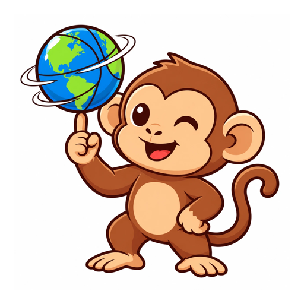

<p align="center">
  
</p>

<h1 align="center">Geoaffe</h1>

<p align="center">
  Tägliche Geografie-Spiele im Browser: sechs kurze Runden, jeden Tag neu, für alle gleich.<br>
  <a href="https://geoaffe.netlify.app"><strong>geoaffe.netlify.app</strong></a>
</p>

---

## Was ist Geoaffe?

Geoaffe ist eine kleine Web-App mit sechs Geografie-Spielen. Jeden Tag um Mitternacht gibt es neue Runden, und alle Spielerinnen und Spieler bekommen dieselben Aufgaben, ähnlich wie bei Wordle. Jedes Spiel bringt bis zu 1.000 Punkte, also maximal 6.000 pro Tag.

Die App läuft komplett im Browser, braucht kein Konto und lässt sich auf dem Handy wie eine richtige App auf den Homescreen legen. Nach dem ersten Öffnen funktioniert sie auch offline.

## Die sechs Spiele

| Spiel | Worum es geht | Runden |
|---|---|---|
| **Nadelwurf** | Eine Stadt oder Sehenswürdigkeit wird genannt. Du setzt eine Nadel auf der unbeschrifteten Weltkarte. Je näher, desto mehr Punkte. | 5 |
| **Grenzgänger** | Finde einen Landweg von Land A nach Land B, nur über gemeinsame Landgrenzen. Land auf der Karte antippen oder eintippen. Weniger Länder bringen mehr Punkte. | 2 |
| **Flaggen-Mix** | Zwei halbe Flaggen sind zu einer zusammengesetzt. Welche zwei Länder stecken drin? | 5 |
| **Nördlicher?** | Zwei bekannte Orte. Welcher liegt weiter im Norden, Süden, Osten oder Westen? | 10 |
| **Näher dran** | Was liegt näher an Stadt X: Stadt A oder Stadt B? | 10 |
| **Tag & Nacht** | Live nach echter Uhrzeit: Wo geht gerade die Sonne auf oder unter, wo ist tiefe Nacht, wo steht die Sonne senkrecht? | 5 |

## Funktionen

- Tägliche Runden mit fester Nummer, für alle gleich, dazu ein Übungsmodus mit unbegrenzt vielen Runden
- Punkte pro Spiel, Tagesfortschritt und Statistik (gespielte Tage, Serie, bester Tag, stärkstes Spiel)
- Ergebnis kopieren und im Chat teilen
- Installierbar als App (PWA) auf iPhone, Android und Desktop
- Offline spielbar dank Service Worker
- Der Spielstand wird lokal im Browser gespeichert

## Auf dem Handy installieren

1. **geoaffe.netlify.app** öffnen.
2. **iPhone (Safari):** Teilen-Symbol → „Zum Home-Bildschirm“.
   **Android (Chrome):** Menü (⋮) → „App installieren“.

## Lokal starten

Die App besteht nur aus statischen Dateien. Der Service Worker braucht einen Webserver, ein Doppelklick auf `index.html` reicht also nicht.

```bash
python3 -m http.server 8000
```

Dann im Browser `http://localhost:8000` öffnen.

## Veröffentlichen

Den Ordnerinhalt auf einen beliebigen statischen Hoster legen, zum Beispiel Netlify (per Drag & Drop oder mit diesem Repo verbunden), GitHub Pages oder Vercel. Die Datei `_headers` setzt auf Netlify den richtigen Dateityp für das App-Manifest.

## Projektstruktur

| Datei | Inhalt |
|---|---|
| `index.html` | Die komplette App: Oberfläche, Spiele-Logik und Karten-Darstellung |
| `data.js` | Spieldaten: Städte, Sehenswürdigkeiten, Länder mit Nachbarländern, Flaggen und die Weltkarte |
| `d3.min.js`, `topojson.min.js` | Bibliotheken für Kartenprojektion und Kartendaten |
| `manifest.webmanifest` | App-Name, Farben und Icons für die Installation |
| `sw.js` | Service Worker für den Offline-Modus |
| `_headers` | Header-Einstellungen für Netlify |
| `icon-*.png`, `apple-touch-icon*.png`, `favicon-32.png` | App-Icons |

## Daten und Genauigkeit

- **Weltkarte und Ländergrenzen:** Natural Earth (1:50 Mio.). Die Nachbarschaften für den Grenzgänger sind aus den gemeinsamen Grenzlinien der Karte berechnet und von Hand gegengeprüft. Regeln: Überseegebiete zählen nicht (Frankreich grenzt also nicht an Brasilien). Der Kosovo ist als eigenes Land dabei, Somaliland zählt zu Somalia. Die rund 150 m lange Grenze Botswana–Sambia ist ergänzt.
- **Städte:** Alle Koordinaten sind mit dem GeoNames-Datensatz abgeglichen. Für Nadelwurf, Nördlicher? und Näher dran werden nur bekannte Städte und Sehenswürdigkeiten verwendet.
- **Entfernungen:** Luftlinie auf der Erdkugel (Haversine-Formel, mittlerer Erdradius 6.371 km)
- **Sonnenstand (Tag & Nacht):** berechnet nach den Formeln des NOAA Solar Calculator, genau für den Moment der Antwort. Tiefe Nacht bedeutet: Sonne mehr als 18° unter dem Horizont.

## Quellen und Lizenzen

| Quelle | Verwendung | Lizenz |
|---|---|---|
| [Natural Earth](https://www.naturalearthdata.com) über [world-atlas](https://github.com/topojson/world-atlas) | Weltkarte, Ländergrenzen | Public Domain / ISC |
| [GeoNames](https://www.geonames.org) | Abgleich der Städtekoordinaten | CC BY 4.0 |
| [flag-icons](https://github.com/lipis/flag-icons) | Flaggen | MIT |
| [D3](https://d3js.org) | Kartenprojektion | ISC |
| [TopoJSON](https://github.com/topojson/topojson) | Kartendaten-Format | ISC |
| [Geist](https://vercel.com/font) (über Google Fonts) | Schrift | SIL Open Font License |

Für den eigenen Code von Geoaffe ist noch keine Lizenz festgelegt.
